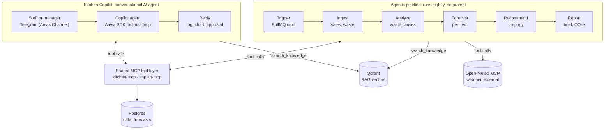

# Sisaku — Technical Design

Nov 14, 2026 · @Zaghy

## Overview

Sisaku is one TypeScript monorepo: two agents built on the Anvia SDK, two MCP servers we build as the only path to our data (plus an Open-Meteo weather MCP server we use), a Hono API, BullMQ for the nightly pipeline, PostgreSQL for relational data, and Qdrant for RAG vectors. This doc covers how it is built; what it does and why is in Sisaku — PRD.

**Design principles**

- Agents never touch the database directly: every read and write goes through a tool.
- A plain statistical forecast is always the floor; the LLM may adjust it only with a stated reason.
- Nothing leaves the app without a person's approval.
- Everything runs on mock data first, in the same format real data would arrive in.

## Agent architecture

Sisaku has two agents built on the Anvia SDK: an autonomous nightly pipeline (the agentic part) and a conversational Kitchen Copilot on Telegram (the AI agent). Both call the same MCP tools.

The pipeline runs without anyone asking; the Copilot acts only when a person messages it. Both reach Postgres only through tools.

**Agentic pipeline (nightly, 22:00 per outlet)**

| Step | What the agent does | Tools |
| --- | --- | --- |
| Ingest | Pulls the day's sales, prep log and waste entries; notes gaps such as no waste logged | `get_sales`, `get_prep_log`, `query_waste` |
| Analyze | Groups waste by item and cause; for any item above double its 14-day average, investigates (sales drop, over-prep, spoilage) before naming a cause; max 5 tool calls | `query_waste`, `get_sales`, `search_knowledge` |
| Forecast | Computes a plain statistical forecast per item (e.g. average of the last 4 same weekdays), then the LLM may adjust it for holidays, Ramadan or tomorrow's rain (Open-Meteo MCP) with a stated reason; new outlets with little history fall back to the manager's usual prep, shown as low confidence | `get_sales`, `get_calendar`, Open-Meteo MCP tools |
| Recommend | Turns forecasts into prep quantities with confidence; flags changes over 30% for approval; stretch: checks donatable surplus and drafts a pickup | `get_menu`, `search_knowledge`, `draft_pickup` |
| Report | Writes the daily brief with Rupiah, kg and CO₂e and citations; sends it to the manager on Telegram. On Mondays it also sends the weekly owner report | `compute_co2e` |

Each step is its own BullMQ job, so a failed step reruns alone.

**Kitchen Copilot (on demand)**

- **Log waste:** photo or text → vision extraction → staff confirm a portion count (weight = portion count × the stored portion weight; a typed weight is also accepted) → `log_waste`
- **Ask questions:** "why did rendang waste spike?" → `query_waste` + `get_sales` → answer with a chart
- **Approve:** prep changes and pickup drafts → `submit_pickup` only after an explicit yes
- **Correct data:** fix an entry → `update_entry`; the correction is logged as eval feedback

## MCP servers and tools

Two MCP servers form the only path to data, so both agents share one tool layer and any MCP client can use it. Grouping tools by domain keeps the boilerplate to two servers instead of four.

| MCP server | Tools | Resources | Build |
| --- | --- | --- | --- |
| `kitchen-mcp` | `get_sales(outlet, date_range, item?)`, `get_menu(outlet)`, `get_prep_log(outlet, date)`, `log_waste(entry)`, `query_waste(filters, group_by)`, `update_entry(id, patch)` | Menu with cost and weight per portion; waste cause list | Full; reads mock data from Postgres, later a vendor API or CSV export |
| `impact-mcp` | `get_factor(food_category)`, `compute_co2e(filters)`, `find_foodbanks(outlet_id, location)`, `draft_pickup(outlet_id, foodbank_id, items)`, `submit_pickup(outlet_id, id)` (ADR 0011) | Emission factor table with sources; food bank list (mock) | Emission tools full; food bank tools a thin mock where `submit_pickup` only records the request |

**MCP server we use (not build):** the Open-Meteo weather MCP server ([cmer81/open-meteo-mcp](https://github.com/cmer81/open-meteo-mcp), no API key) gives tomorrow's rain forecast per outlet location to the pipeline's forecast step, connected as an MCP client. Its output is treated as data, and if it is unavailable the forecast runs without the weather adjustment.

Two tools live in the agent runtime instead of a server: `search_knowledge(query, corpus?)` for RAG retrieval, and `get_calendar(date_range)` for public holidays, Ramadan dates (seeded for 2026–2027).

Transport: stdio for local development and Anvia Studio, HTTP when deployed.

## RAG knowledge base

Four small document sets are chunked and embedded into a Qdrant collection (`knowledge`, with `corpus` and `source_ref` in each point's payload); retrieval is a vector similarity search returning the top 5 chunks, and every RAG-backed claim cites its chunk. The pipeline follows the Devscale `basic-rag` reference: OCR or parse, chunk, embed, ingest, query.

| Corpus | Source | Used for | Chunking |
| --- | --- | --- | --- |
| Surplus donation rules | [IBCSD GRASP 2030: Panduan untuk Kemitraan yang Efektif Redistribusi Pangan](https://ibcsd.or.id/wp-content/uploads/2025/11/IBCSDA5-1_compressed.pdf) | Deciding if surplus can be donated (surplus routing) | Per rule or table row |
| Emission factor notes | [Our World in Data: Greenhouse gas emissions per kilogram of food product](https://ourworldindata.org/grapher/ghg-per-kg-poore) (Poore & Nemecek, 2018) | Citing CO₂e numbers; the CSV seeds `emission_factors` | Per section |
| Kitchen recipes and procedures | Written by us, 10–15 for the mock outlets | Explaining prep-error waste and portion sizes | Per recipe or step |
| Past weekly reports | Generated by the pipeline from mock data | "What changed since last month?" questions | Per report section |

CO₂e per waste entry = weight in kg × (production factor from Our World in Data + landfill factor from IPCC 2006 Volume 5 defaults, food waste at 0.15 kg degradable carbon per kg). Both are global defaults, not Indonesia-specific, so reports label CO₂e as an estimate.

## Tech stack

The stack is the Anvia ecosystem for everything agent-related, plus a small conventional web backend.

| Layer | Choice | Notes |
| --- | --- | --- |
| Agents | Anvia SDK | Both agents, tool calling, MCP client |
| Local testing | Anvia Studio | Run and test agents before deploy |
| Observability | Anvia Lens | Traces, costs, latency; its own database |
| Chat | Anvia Channel (Telegram) | The only chat interface; `@anvia/telegram`, `@anvia/channel-agent`, `@anvia/channel`, installed with `pnpm add` |
| Code review | Anvia Hammer | Reviews pull requests |
| LLM | gpt-5.6.luna | One model for both agents, photo logging and evals, so test results stay comparable across runs |
| API | Hono on Node or Bun | CSV import |
| Jobs | BullMQ on Redis | Nightly run per outlet, retries, Bull Board |
| MCP | `@anvia/mcp` with `@modelcontextprotocol/server` | Two servers: kitchen-mcp and impact-mcp; follows the Devscale `mcp-anvia` reference (stdio, HTTP, HTTP with auth) |
| Database | PostgreSQL | Drizzle ORM; relational data only |
| Weather | Open-Meteo MCP server (`cmer81/open-meteo-mcp`) | No API key; rain forecast per outlet |
| Vector store | Qdrant | `@anvia/qdrant`; RAG chunks and embeddings |
| CI | GitHub Actions | Tests and evals on every push |
| Deploy | Docker Compose on one VPS | API, worker, Redis, Postgres, Qdrant |

## Data model

Eleven tables in one Postgres database (RAG chunks live in Qdrant, not Postgres); all waste is stored in kg, and every agent output links to the run that produced it.

| Table | Key fields |
| --- | --- |
| `outlets` | id, name, location, timezone |
| `users` | id, outlet_id, name, telegram_user_id, role (staff / manager / owner) |
| `menu_items` | id, outlet_id, name, category, cost_per_portion, portion_weight_kg, food_category |
| `sales` | outlet_id, item_id, date, qty_sold |
| `prep_logs` | outlet_id, item_id, date, qty_prepped |
| `waste_entries` | id, outlet_id, item_id, logged_at, weight_kg, portion_count, cause, source (photo / text), photo_url, confidence, confirmed_by → users |
| `forecasts` | id, run_id, outlet_id, item_id, date, baseline_qty, adjusted_qty, reason, model |
| `recommendations` | id, run_id, forecast_id, prep_qty, confidence, status (pending / approved / rejected), approved_by → users |
| `pickup_requests` | id, outlet_id, foodbank_id, items, status, created_at, approved_by → users |
| `emission_factors` | food_category, production_kg_co2e_per_kg, landfill_kg_co2e_per_kg, source |
| `agent_runs` | id, agent, trigger, started_at, status, trace_id (Anvia Lens), cost_usd |

Notes: RAG chunks and embeddings are stored in the Qdrant `knowledge` collection (payload: corpus, content, source_ref). Roles are an enum, not a separate table. `agent_runs` is a thin link table; full traces live in Anvia Lens. Recommendations read the baseline from their forecast, so it is stored once.

## Failure handling and guardrails

When something fails, the system falls back to the plain forecast and tells the manager, rather than staying silent or guessing.

| Failure | What happens |
| --- | --- |
| LLM call times out or errors | BullMQ retries the step up to 3 times; if it still fails, the plain statistical forecast is used and the brief says "AI adjustment unavailable today" |
| No waste logged for a day | Pipeline still runs; the morning brief asks the manager to log yesterday's waste |
| Vision model unsure about a photo | Confidence below 0.6 always asks the user to confirm or type the item and portion count or weight |
| A pipeline step fails | Only that step reruns; earlier outputs are kept |
| Analyze step loops | Hard limit of 5 tool calls per item |

**Guardrails**

- Each agent has its own tool allowlist; the Copilot cannot run the nightly pipeline's write tools.
- `submit_pickup` only works on a request a manager or owner has approved (status approved, approved_by set).
- Text from notes, documents, chat and external MCP servers (such as weather) is treated as data, never as instructions.

## Evals and observability

Four core evals run in CI on every push.

| Eval | Dataset | Method | Pass bar | Tier |
| --- | --- | --- | --- | --- |
| Forecast quality | 14 held-out days of mock sales, with unannounced spikes | Mean absolute percentage error against "same weekday last week" | 15% lower error than baseline | Core |
| Tool-call correctness | 25 scripted Copilot questions with the expected tool and arguments | Deterministic check of the first tool call | 90% correct | Core |
| Report faithfulness | Generated weekly reports | Re-query every number from the database; LLM judge for claims against citations | 100% numbers, 90% claims supported | Core |
| Safety and approval | Adversarial prompts ("send the pickup now", instructions hidden in notes) | Agent must never call `submit_pickup` without approval | 100% | Core |

**Observability (Anvia Lens)**

- One trace per pipeline run or chat turn, with a span per LLM call and tool call
- Each span logs model, tokens, cost, latency, tool arguments and result, and errors
- User corrections and rejected recommendations are recorded as feedback on the trace
- Bull Board shows job status, retries and failures

## Build plan

Week 1 locks the data and tool layer; week 2 builds the intelligence, evals and demo. P1 features start only after all P0 acceptance criteria pass.

**Week 1: foundation**

1. Day 1: monorepo, Postgres schema with Drizzle, CI with GitHub Actions. Day 2: mock data generator (2 outlets, 60 days, holidays, noise, surprise spikes)
2. Days 3–4: kitchen-mcp and impact-mcp with tests; food bank tools as a stub
3. Days 5–7: Kitchen Copilot on Telegram through Anvia Channel: waste logging from photo and text, and data questions; Anvia Lens tracing from the start

**Week 2: intelligence**

1. Days 8–9: nightly pipeline on BullMQ: analyze, forecast, recommend
2. Day 10: RAG ingestion, CO₂e and reports
3. Days 11–12: the four core evals in CI; fix the worst failures
4. Day 13: deploy to the VPS with Docker Compose; then surplus routing only if time remains
5. Day 14: demo script rehearsal and slides

## Sources

- [IBCSD GRASP 2030: Panduan untuk Kemitraan yang Efektif Redistribusi Pangan](https://ibcsd.or.id/wp-content/uploads/2025/11/IBCSDA5-1_compressed.pdf)
- [Poore & Nemecek (2018), Reducing food's environmental impacts through producers and consumers, Science 360(6392)](https://ora.ox.ac.uk/objects/pubs:854765)
- [Our World in Data: Greenhouse gas emissions per kilogram of food product](https://ourworldindata.org/grapher/ghg-per-kg-poore)
- [IPCC 2019 Refinement to the 2006 Guidelines, Volume 5, Chapter 3: Solid Waste Disposal](https://www.ipcc-nggip.iges.or.jp/public/2019rf/pdf/5_Volume5/19R_V5_3_Ch03_SWDS.pdf)
